# 3D Machine Learning — Multi-View 3D Reconstruction

> Transformer-based pipeline for reconstructing 3D voxel occupancy grids from single or multiple 2D images, trained and evaluated on ShapeNet.

Built as part of the **Machine Learning for 3D Geometry** course (SS23) at TUM.

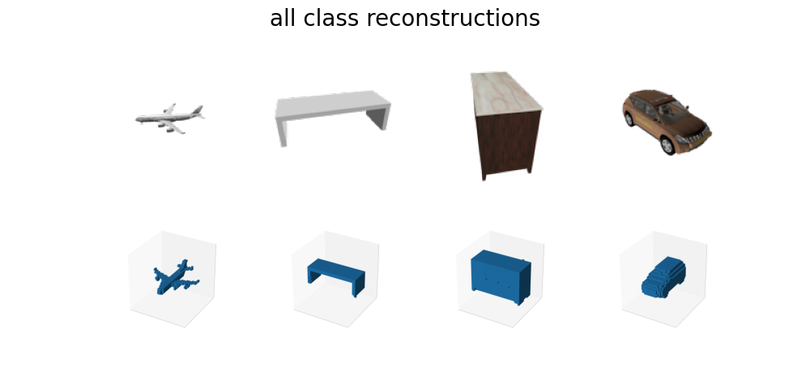

## Project — 2D → 3D Shape Reconstruction

The main project (`Project/`) implements an end-to-end model that takes one or more 2D renderings of a 3D object and predicts its 32³ voxel occupancy grid.

### Pipeline

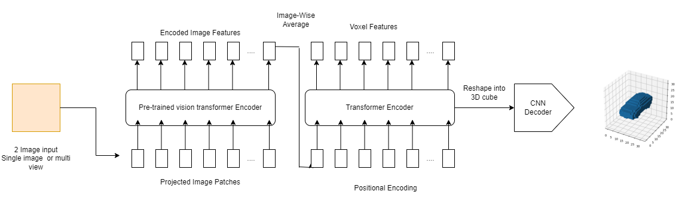

### Architecture

| Component | Description |
|---|---|
| **Encoder** | Pretrained DeiT (Data-efficient Image Transformer) extracts patch-level features from input images |
| **View Fusion** | Transformer-based or average-pooling fusion to aggregate features across multiple views |
| **Transformer Decoder** | Learned positional embeddings decoded through a multi-layer transformer |
| **3D Decoder** | Residual 3D-CNN with transposed convolutions upsamples latent codes to a 32³ voxel grid |
| **Loss** | Dice + BCE composite loss with configurable positive-class weighting |
| **Metric** | Intersection-over-Union (IoU) on binarized voxel predictions |

### Project Structure

```
Project/src/
├── models/
│   ├── Transform2D.py       # Main model: DeiT encoder → transformer decoder → 3D CNN
│   └── base_model.py        # Base class with save/load/train utilities
├── blocks/
│   ├── patch_encoder.py      # Patch-based image encoding
│   ├── transformer_encoder.py
│   ├── transformer_decoder.py
│   ├── view_fusion.py        # Multi-view feature fusion
│   ├── simple_decoder.py     # 3D transposed-conv decoder
│   ├── torch_encoder.py      # CNN-based 2D encoder (alternative)
│   └── torch_decoder.py      # CNN-based 3D decoder (alternative)
├── datasets/
│   └── shape_net.py          # ShapeNet dataloader with voxel + multi-view images
├── losses/
│   ├── build_loss.py         # Loss factory (BCE / Dice / Dice+BCE)
│   ├── dice_loss.py
│   └── dice_loss_bce.py
├── evaluation/
│   └── Evaluation.py         # Per-class IoU evaluation with top-k visualizations
├── configs/
│   └── global_configs.yaml   # All hyperparameters and training settings
└── utils/
    ├── util.py               # IoU computation, seeding, image I/O
    ├── visualizations.py     # Voxel and point-cloud visualization
    ├── model_utils.py        # Weight initialization
    ├── constants.py          # Dataset paths and defaults
    └── binvox_rw.py          # Binvox file reader
```

### Usage

**Training**
1. Adjust hyperparameters in `Project/src/configs/global_configs.yaml`
2. Run the `Project/src/train.ipynb` notebook

**Evaluation**
1. Set `evaluation.ckpt_path` in the config to the desired checkpoint
2. Run the `Project/src/evaluation.ipynb` notebook

### Checkpoints & Results

[All checkpoints, experiments, results, TensorBoard logs, and training visualizations (Google Drive)](https://drive.google.com/drive/folders/1zppUpldYmmwKAwD0guCpYVZuU1NZEck-?usp=sharing)

---

## Exercises

The course exercises build foundational 3D ML skills:

### Exercise 1 — Point Clouds, Occupancy Grids & Marching Cubes

Implicit surface representations (SDF), occupancy grids, point cloud processing, and mesh extraction via marching cubes.

<p align="center">
  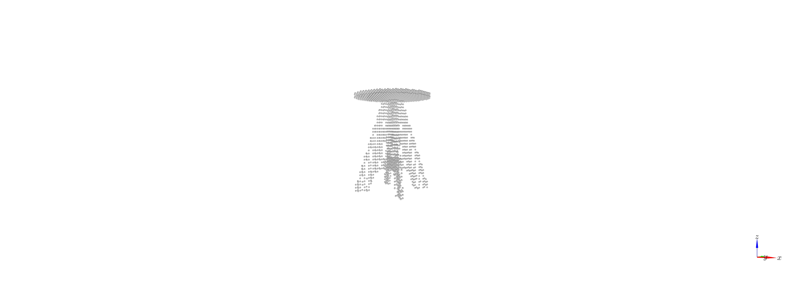
  
  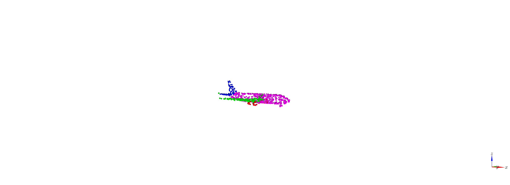
</p>
<p align="center">
  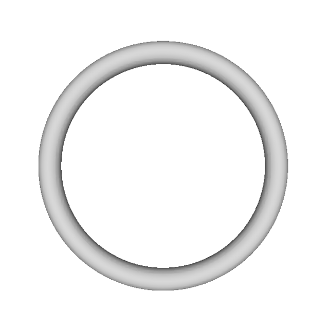
  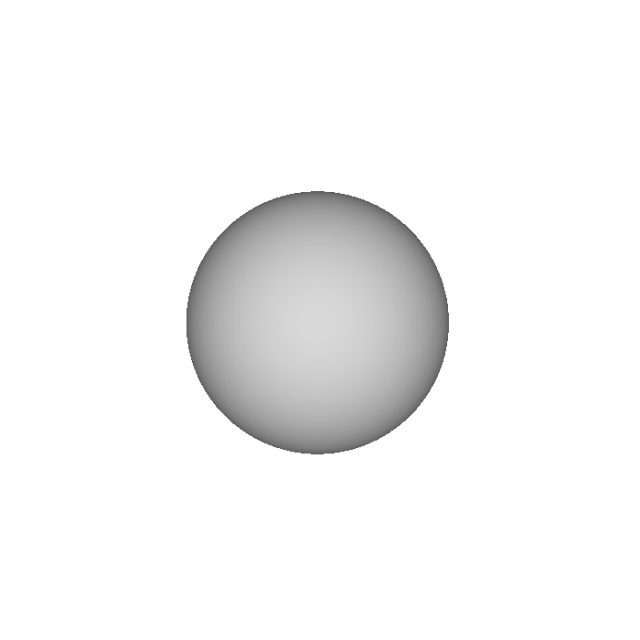
  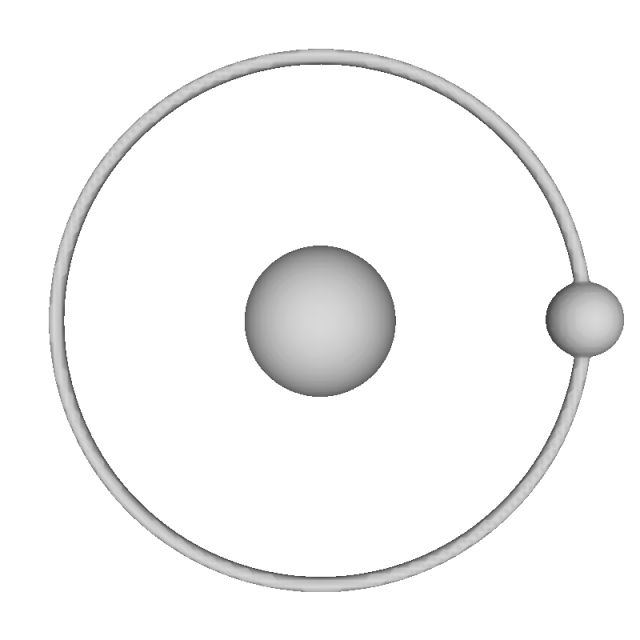
</p>

### Exercise 2 — Learning Implicit Representations

Neural network–based implicit function learning for 3D shape representation, including training and inference pipelines.

<p align="center">
  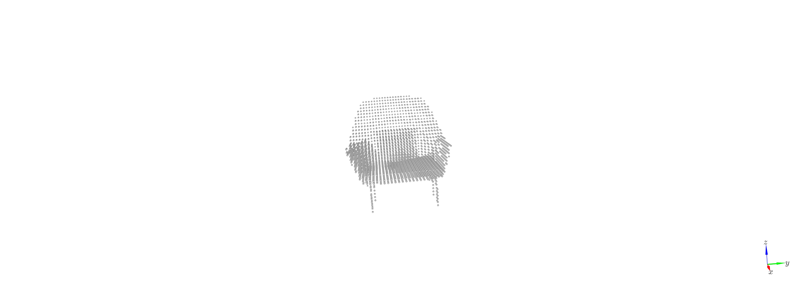
  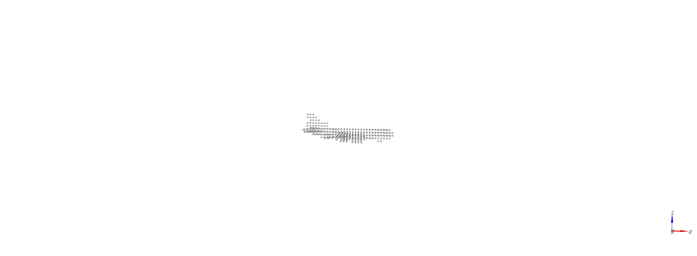
  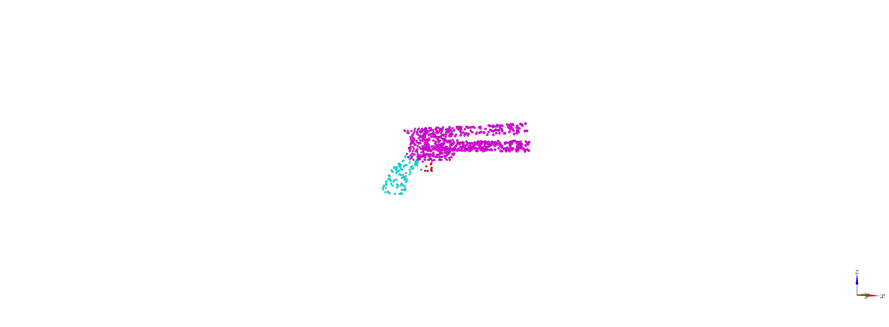
  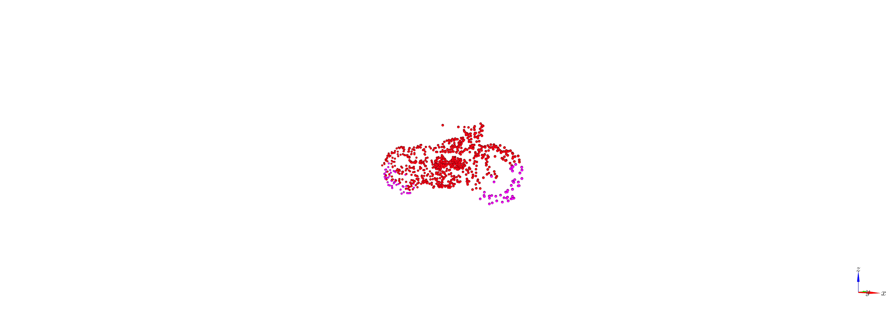
</p>

### Exercise 3 — DeepSDF

Implementation of DeepSDF for learning continuous signed distance functions, with latent space interpolation and shape completion.

<p align="center">
  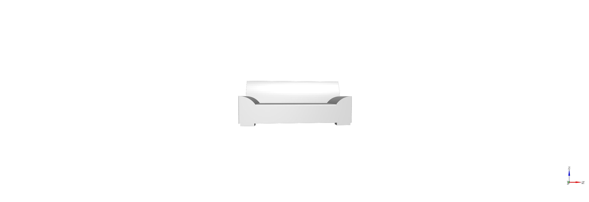
  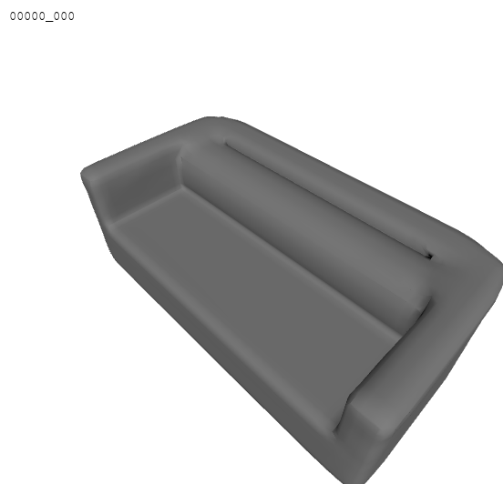
  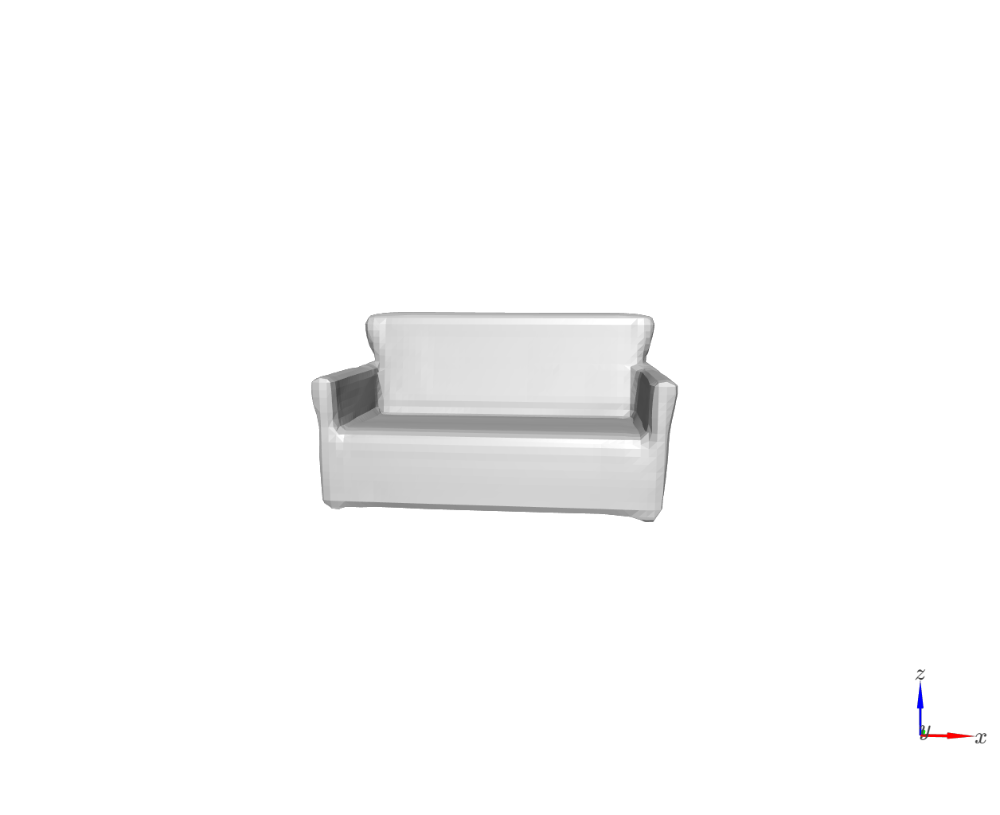
  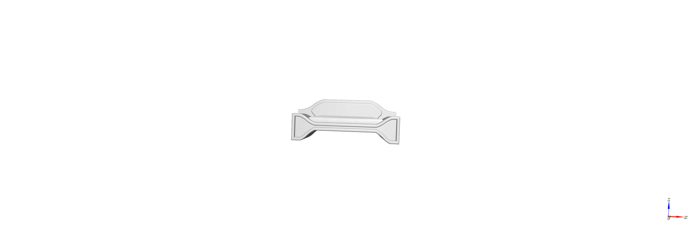
</p>

---

## Setup

```bash
cd Project
poetry install
poetry shell
pip install torch==1.11.0+cu113 torchvision==0.12.0+cu113 torchaudio==0.11.0+cu113 \
    -f https://download.pytorch.org/whl/cu113/torch_stable.html
```

Run `Project/src/inital_setup.ipynb` to download the ShapeNet dataset.

## Team

- **Biray Sutcuoglu** — biray.sutcuoglu@tum.de
- **Michael Kubitza** — michael.kubitza@tum.de
- **Youssef Youssef** — youssef.youssef@tum.de
